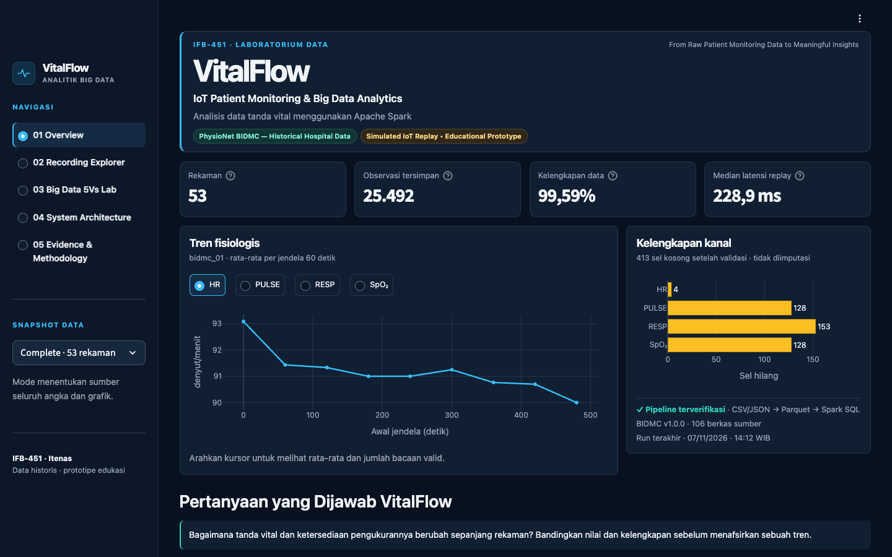
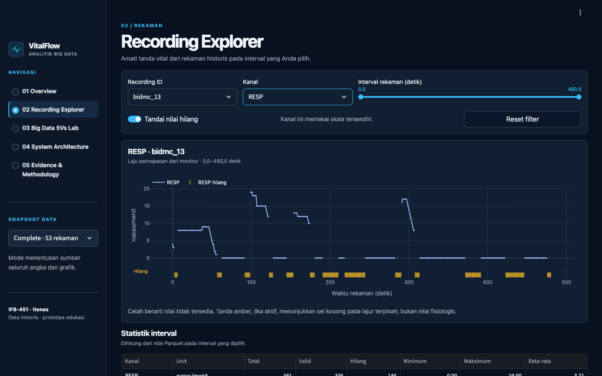
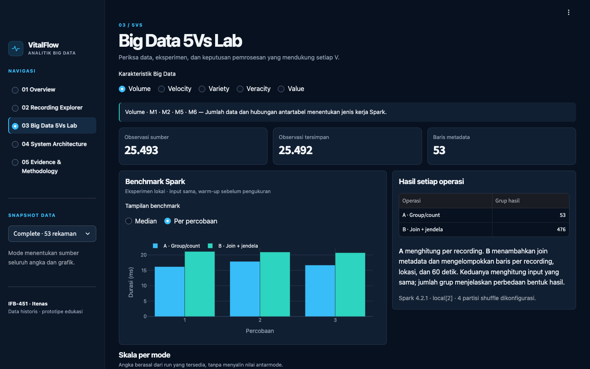
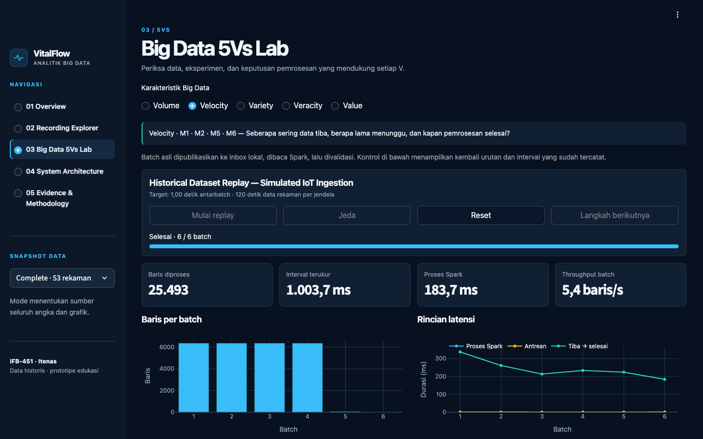
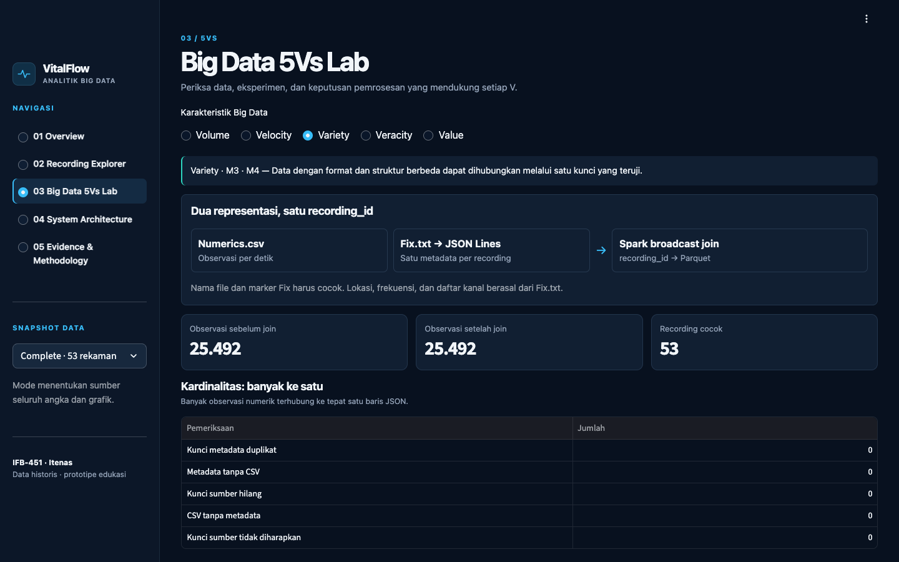
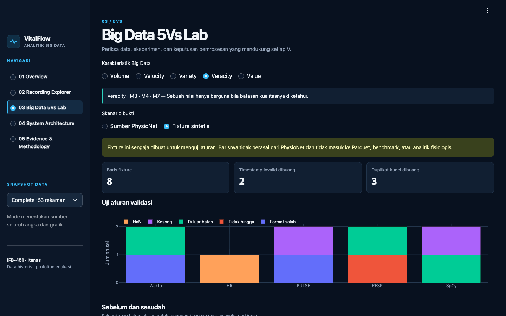
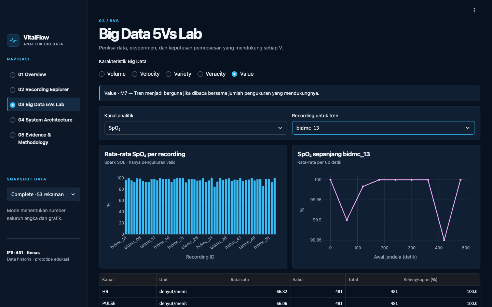
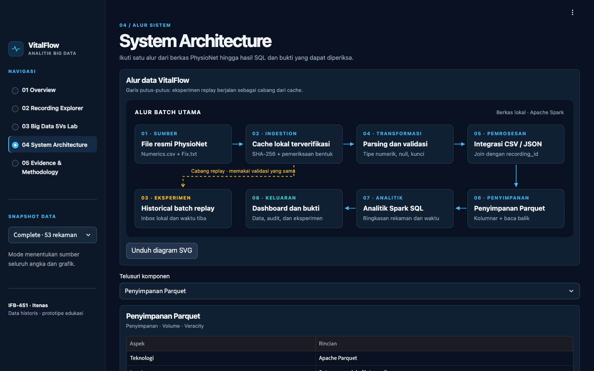
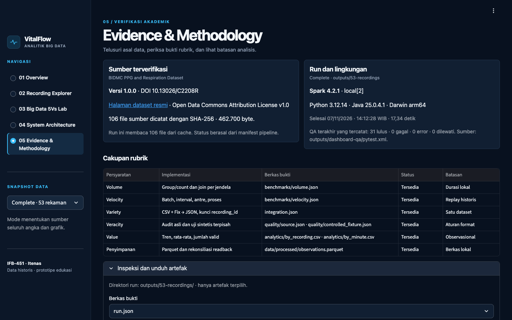

# VitalFlow

**IoT Patient Monitoring & Big Data Analytics · Iteration 02**

VitalFlow answers a monitoring question: **how do the levels and completeness of HR, pulse, respiration, and SpO₂ vary over a recording?** It builds a reproducible local Spark pipeline for the Itenas IFB-451 midterm. It integrates official BIDMC numerics with recording metadata, audits quality, writes and reads back Parquet, and produces evidence for all five Vs.

**Historical hospital monitor data · Simulated batch arrivals · Educational analysis.** This prototype has no connection to live devices and makes no clinical predictions or recommendations.

## Preview

Screenshots use the verified **Complete · 53 rekaman** snapshot.



| Recording Explorer | Big Data 5Vs Lab · Volume |
|:---:|:---:|
|  |  |
| **Velocity** | **Variety** |
|  |  |
| **Veracity** | **Value** |
|  |  |
| **System Architecture** | **Evidence & Methodology** |
|  |  |

## Launch the dashboard

From the VitalFlow directory with its Python 3.12 virtual environment:

```sh
source .venv/bin/activate
python -m pip install -e '.[dashboard,dev]'
python -m streamlit run dashboard/app.py --server.headless true --server.port 8512
```

Open [http://127.0.0.1:8512](http://127.0.0.1:8512). The default selection is Complete. Choose **Fast**, **Default**, or **Complete** in the sidebar to load the corresponding verified snapshot. If that snapshot is missing, the dashboard provides the commands to generate it. For example, after downloading the full dataset once, `vitalflow run --mode complete` rebuilds the evidence without internet access.

The dashboard uses local evidence and does not start Spark. Streamlit, Plotly, and pandas present the saved outputs. PyArrow reads the selected recording from Parquet; the other pages use precomputed evidence. The simulated replay animates archived arrival intervals and measurements. It does not rerun ingestion or modify benchmark files. Use the [five-minute demonstration guide](docs/dashboard-demo.md) and the [dashboard verification record](docs/dashboard-verification.md).

Run both dashboard and pipeline checks offline with:

```sh
python -m pytest -q --junitxml=outputs/dashboard-qa/pytest.xml
ruff check .
ruff format --check .
```

## Start here

Use CPython 3.12 and a supported JDK. The tested stack on Apple Silicon was **Python 3.12.14, Temurin 25.0.4.1, PySpark 4.2.1, and pytest 8.4.2**. Spark runs with two local worker threads. See the [Spark 4.2.1 requirements](https://spark.apache.org/docs/4.2.1/) for supported JDKs; use the tested versions for the closest reproduction. If macOS has several JDKs, select Java 25 with `export JAVA_HOME="$(/usr/libexec/java_home -v 25)"`.

If Python 3.12 is missing on macOS, install it with [Homebrew](https://formulae.brew.sh/formula/python@3.12): `brew install python@3.12`. If you need a JDK, get the macOS ARM64 JDK from [Eclipse Adoptium](https://adoptium.net/temurin/releases/?version=25).

From the directory containing this README:

```sh
python3.12 --version
java -version
python3.12 -m venv .venv
source .venv/bin/activate
python -m pip install -e '.[dev]'
python -m pip check

vitalflow download --mode fast    # Internet; six data files and official checksums
vitalflow run --mode fast         # Offline; outputs/03-recordings/
python -m pytest -q               # Offline; uses isolated synthetic fixtures
```

The editable install keeps the CLI and its generated paths anchored to this checkout, even when called from another working directory. The script wrappers `python scripts/download_data.py` and `python scripts/run_pipeline.py` accept the same options as their respective subcommands. Python 3.9 shipped with some versions of macOS does not meet the project requirement.

| Selection | Recordings | Output |
| --- | ---: | --- |
| `--mode fast` | 3 | `outputs/03-recordings/` |
| `--mode default` or no flag | 10 | `outputs/10-recordings/` |
| `--mode complete` | 53 | `outputs/53-recordings/` |
| `--recordings N` | First N, 1–53 | `outputs/NN-recordings/` |

For the full evidence set, run `vitalflow download --mode complete`, then `vitalflow run --mode complete`. Once downloaded, repeat either `vitalflow download --mode complete --offline` to verify the cache or `vitalflow run --mode complete` to regenerate the artifacts. `--replay-interval 0.5` changes the target wall-clock interval in seconds. The default is 1 second. Reports distinguish source elapsed time from replay wall-clock time.

## Read a run

Each recording count has its own generated snapshot. Open these files in order:

| Artifact | What it shows |
| --- | --- |
| `run.json` | Runtime, row accounting and execution summary |
| `provenance.json`, `source_schema.json` | Verified file URLs, checksums, exact headers and observed token types per recording |
| `data/metadata/recordings.jsonl`, `integration.json` | Derived JSON, join cardinality, typed schemas and example output |
| `quality/source.json`, `quality/time_coverage.csv` | Before/after source quality and sampling cadence by recording |
| `quality/controlled_fixture.json` | Separate stress test for duplicate and invalid inputs |
| `data/processed/observations.parquet/` | Verified integrated data |
| `analytics/by_recording.csv`, `analytics/by_minute.csv` | Spark SQL descriptive statistics, valid counts and completeness |
| `benchmarks/volume.json`, `benchmarks/*_plan.txt` | Materialized timings and plans for group/count vs. join plus time grouping |
| `benchmarks/velocity.json`, `benchmarks/velocity_batches.csv` | Measured local arrivals, processing, queue waits, and counts |

The complete selection is the best evidence for Veracity: the original data contain missing readings and one negative elapsed timestamp. The fast selection still exercises the same pipeline and includes the separate controlled quality report.

## Reproduce and troubleshoot

- A missing file in `run` or `download --offline` means the selected cache is incomplete. Run `vitalflow download` with the same selection while online. Verified files are reused; a partial failure preserves successfully validated files.
- A checksum mismatch stops execution. Move the named invalid file out of the cache and rerun `download`. VitalFlow never replaces a raw file. The PhysioNet checksums and cached bytes live under `data/raw/bidmc/1.0.0/`.
- For a Java gateway error, check `java -version` and `JAVA_HOME` before restarting. Spark may warn that native Hadoop libraries are unavailable on macOS; this run uses bundled Java libraries and local files. No Hadoop server, Kafka, cloud service, Docker, or API key is required.
- To keep notes or copy a run for submission, store them outside `outputs/NN-recordings/`. That directory is reserved for generated artifacts and is replaced on a successful rerun. Timing, run timestamps, Spark plan IDs, and Parquet part filenames can change; inputs and analytical contents should be stable.

See the [architecture](docs/architecture.md), [dataset and citations](docs/dataset.md), [methodology](docs/methodology.md), [evidence and team roles](docs/evidence-matrix.md), [engineering decisions](docs/decisions.md), and [verification record](docs/verification.md). The final five-minute video and three-page submission PDF are reserved for Iteration 03.
