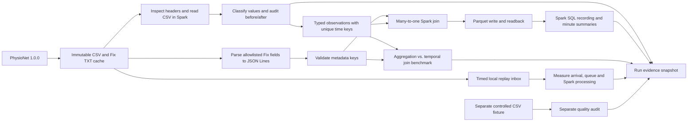

# Architecture · Iterations 01–02

- **Source and storage:** `acquisition.py` checks the official digest and file structure before caching each immutable source file. `source.py` validates headers and derives only allowlisted fixed metadata. Generated data stay under each run's `data/metadata` and `data/processed` directories.
- **Spark processing:** `spark.py` creates a local session and reads each CSV layout by exact header. `quality.py` classifies and converts cells using Spark expressions and removes invalid/duplicate time keys. `integration.py` reads actual JSON Lines and verifies the recording key set before broadcasting the small metadata lookup.
- **Analysis and evidence:** `pipeline.py` verifies the integrated row count and Parquet round trip. `analytics.py` summarizes reloaded Parquet with Spark SQL and records execution plans and action timings. `replay.py` measures independent timed arrivals. `artifacts.py` stages results and publishes them under a lock for each selection.
- **Delivery surface:** The CLI is the demonstration interface in Iteration 01. The Iteration 02 dashboard consumes published CSV and JSON summaries. PyArrow reads only the selected recording and needed columns from Parquet. The dashboard does not access raw Fix files or rerun Spark.

The acquisition and replay staging code use Python's standard library for this small file set. Joins, quality aggregates, deduplication, Parquet, and analytical queries run in Spark. Only bounded reports are collected into Python. The Spark pipeline does not need pandas. The dashboard uses pandas for the small SQL summaries and the filtered detail of a single recording.
